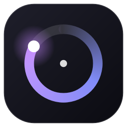
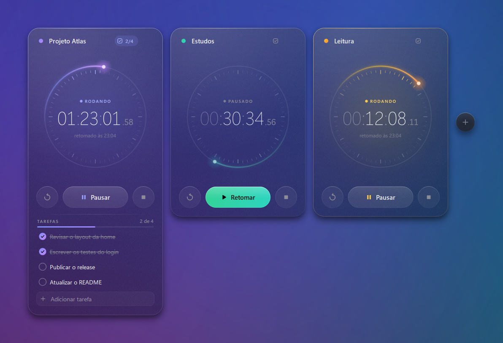
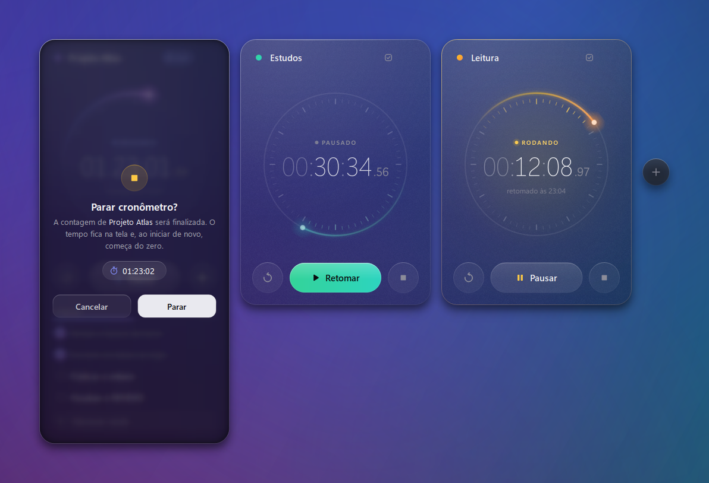

<div align="center">



# Cometa

**Cronômetros de vidro que flutuam na sua área de trabalho e continuam contando mesmo com o app fechado.**

[](https://github.com/caiquepessan/cometa/releases/latest)
[](https://github.com/caiquepessan/cometa/actions/workflows/ci.yml)
[](LICENSE)




</div>

## Por que o Cometa

- **O tempo não se perde.** Cada cronômetro guarda o horário em que começou a contar, então
  ele segue rodando com o app fechado, depois de reiniciar o PC ou se algo der errado.
- **Flutua sobre o que você estiver fazendo.** Sem moldura de janela: só os cartões de vidro
  e o botão **+**. Fica sempre no topo (se você quiser) e se move arrastando o próprio cartão.
- **Vários ao mesmo tempo.** Um cronômetro por projeto, matéria ou tarefa, lado a lado, cada
  um com nome e cor.
- **Tarefas em cada cronômetro.** Liste o que falta fazer naquele projeto, marque como
  concluído e acompanhe o progresso pela barra e pelo contador no topo do cartão.
- **Sem sustos.** Pausar é instantâneo; Parar, Zerar e Remover pedem confirmação dentro do
  próprio cartão.
- **Leve.** Um cometa de luz dá a volta no mostrador a cada minuto, e com tudo parado o app
  não gasta CPU.

## Instalação

1. Baixe o **`Cometa-<versão>-windows-x64.zip`** na
   [página de releases](https://github.com/caiquepessan/cometa/releases/latest).
2. Extraia o zip e dê dois cliques em **`Instalar Cometa.cmd`**.

O instalador não pede administrador: ele copia o app para `%LOCALAPPDATA%\Programs\Cometa`,
cria atalhos no Menu Iniciar e na Área de Trabalho e registra o Cometa em
**Configurações > Aplicativos**, de onde dá para desinstalar.

> O executável não tem assinatura digital, então o Windows pode mostrar o aviso do
> SmartScreen na primeira vez. Clique em **Mais informações** e depois em **Executar assim mesmo**.

Prefere não instalar? Rode `app\Cometa.exe` direto da pasta extraída.

## Como usar

| Ação | Como |
| --- | --- |
| Iniciar, pausar e retomar | botão central (instantâneo) |
| Parar | botão ■: finaliza a contagem; o tempo final fica na tela e Iniciar recomeça do zero |
| Zerar | botão ↺: volta para 00:00:00 |
| Novo cronômetro | botão **+** ou `Ctrl+N` |
| Renomear | clique no nome (Enter confirma, Esc cancela) |
| Trocar a cor | clique na bolinha ao lado do nome |
| Remover | passe o mouse no cartão e use a lixeira |
| Tarefas | botão ☑ no topo do cartão; Enter adiciona, o círculo marca como concluída, duplo clique edita e o × remove |
| Mover a janela | arraste qualquer cartão |
| Fechar, minimizar e sempre no topo | aparecem ao lado do **+** ao passar o mouse, ou no clique direito |



## Rodar a partir do código

Requer Python 3.10 ou mais recente.

```bat
python -m pip install -r requirements.txt
python -m cometa
```

Ou dê dois cliques em `Cometa.pyw` (abre sem console). Para rodar os testes:

```bat
python -m unittest discover -s tests
```

## Gerar o instalador

```bat
python -m pip install pyinstaller
python packaging\build.py dist
```

Isso cria `dist\Cometa\` (a pasta do instalador) e `dist\Cometa-<versão>-windows-x64.zip`.

## Como funciona

- **Persistência:** o estado fica em `%APPDATA%\Cometa\state.json`, gravado de forma atômica a
  cada mudança. Um cronômetro rodando guarda só o horário de início e o tempo decorrido é
  calculado na hora, por isso nada se perde com o app fechado.
- **Vidro:** o Acrylic do Windows vira uma cor sólida quando os "Efeitos de transparência"
  estão desligados, então o Cometa desenha o próprio vidro: o papel de parede desfocado,
  alinhado à posição de cada cartão na tela.
- **Feito com** Python e [PySide6](https://doc.qt.io/qtforpython-6/) (Qt 6). O mostrador, o
  cometa, os ícones e as animações são todos desenhados com `QPainter`.

## Licença

[MIT](LICENSE)
